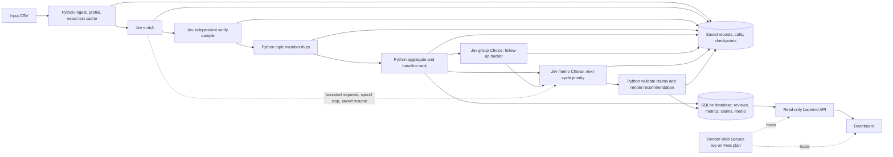

# Spotify Review Insight Pipeline

This project analyzes the supplied historical Spotify review extract using a staged, auditable pipeline. The 100-, 500-, and 10,000-review Jev checkpoints have been run and saved. See [PROJECT_GUIDE.md](PROJECT_GUIDE.md) for a plain-language walkthrough of the work, labels, costs, and next steps.

## Final assignment status

The saved run covers the approved 100,000-review subset, plus all 13 empty-text source rows as quarantines. The full 660,622-row source was profiled. See the ingestion and grading artifacts for the exact coverage counts.

The local checker confirms 100,000 completed classifications, 13 quarantines, no missing in-scope IDs, and 21,901 valid exact-text cache reuses. Its status remains `review_required` because 12 failed attempts still have unavailable token usage (24 fields); successful bounded Jev `group` and `memo` calls are logged. The corrected SQLite-backed API and dashboard are live at [https://spotify-review-insights-e5lu.onrender.com](https://spotify-review-insights-e5lu.onrender.com) on Render's Free plan; all live routes and the dashboard were verified against the 100,013-row snapshot. The synthetic planted-error test passed; the first injection prompt failed on intent, and version 2 passed the same synthetic safety criteria. The 100,000 historical output remains on its original prompt version.

## Rubric evidence map

| Rubric area | Evidence |
|---|---|
| Deliverable quality | [Architecture and labels](PROJECT_GUIDE.md), [grading export](grading/README.md), [decision memo](grading/memo.md), [reproducible claims](grading/claims.csv) |
| Testing and evaluation | [Golden 50 comparison and error analysis](cost/review_100000_quality.md), [mechanical self-check](grading-self-check.json), [planted-error and prompt-injection checks](grading/tests/README.md), [pilot and offline calculator](cost/README.md) |
| Working result | [100,000-row records](grading/records.jsonl), [reproducible ranking](grading/ranking.csv), [live interruption/resume snapshots and recording](evidence/README.md), [database-backed dashboard](dashboard/README.md) |
| Completion status | See the evidence files linked above and the course submission portal for final submission. |

The real synthetic interruption/resume demonstration, matching before/after snapshots, and screen recording are in [`evidence/`](evidence/README.md). The separate `grading/checkpoint_before.json` for the assignment-scale run is reconstructed from saved run evidence, not captured live. Course-portal submission remains open. The dashboard's model-selected priority and grouping follow-up are recorded in `grading/ai_recommendation.json` and `grading/ai_grouping.json`; code renders the memo using saved calculations and review evidence.

## Source provenance

Dataset: [BwandoWando, 3.4 Million Spotify Google Store Reviews, version 2](https://www.kaggle.com/datasets/bwandowando/3-4-million-spotify-google-store-reviews), published as CC0: Public Domain. The supplied course extract `Data/spotify_reviews_18months.csv` has SHA-256 `1fc85de68a304dd8978b537cfa58793d5f41cbaf417fa32cb53899f83a2fcef6`. The raw CSV is excluded from this repository; obtain it from the course materials before rebuilding the sample.

## Architecture and data trace



Role handoffs: enrichment receives review text and emits the shared labels and evidence; verification receives a saved proposed label and source text; Python creates complaint-topic memberships and baseline metrics; the group Choice receives those metrics plus two saved review examples per topic and flags one bucket for follow-up; the memo Choice receives the same evidence plus that group result and selects a priority. Python validates the chosen issue against the saved ranking and renders numbers/evidence using `claims.csv`. `grading/calls.jsonl` stores the role inputs, choices, probabilities, usage, and review IDs. Failed requests are not retried automatically; the cold runner keeps bounded retry, spend-stop, checkpoint, and resume controls.

The historical 100,000 run used Jev for enrichment and verification; Python created broad topic buckets and ranked them. A subsequent bounded group call selected `topic-other` for finer subtopic review, and a memo call selected `topic-usability` for next-cycle investigation. Neither call changed baseline memberships or ranking. Python rendered the recommendation from the model choice, saved calculations, claim IDs, and review evidence.

Example trace: review `553d99de-099a-4413-b9dd-4f4fe508f36a` has source text “Removed all the basic features.” The saved enrichment labels it `usability` / `complaint`, severity 3, with an exact-text evidence quote. Its field confidence was below the 0.5 review threshold, so `needs_review=true`; the verification record stores support probability 0.57, and `grading/calls.jsonl` records a successful verifier request for the ID. The review belongs to `topic-usability`, ranked first with 13,886 complaints and a 37,501 severity sum. Those figures are `r01-complaint_count`, `r01-severity_sum`, and `r01-priority_score` in `grading/claims.csv`, cited in the decision memo. An ambiguous-label example and its handling are discussed in the [quality review](cost/review_100000_quality.md).

## Project status

- Source dataset is in `Data/`; its full CSV is excluded from Git by `.gitignore`.
- The reviewed golden labels are in `Data/golden_50_labeled.csv`. They are evaluation-only and must not be included in development prompts, routing rules, or issue discovery.
- The 100-, 500-, and 10,000-review results, cost report, and call/run logs are saved under `cost/`.
- Read `Data/GRADING_CONTRACT.md` and `Data/COST_CALCULATOR.md` before running model work.
- See [`cost/README.md`](cost/README.md) for pilot measurements and offline replay instructions.

## Low-cost design

Use Python or SQL for CSV parsing, source accounting, exact-text deduplication and cache lookup, schema checks, aggregation, and ranking. Jev handles fixed labels, verification, and two bounded decisions over saved group metrics and review evidence. Code keeps memberships, ranking, cost checks, evidence validation, and memo number rendering deterministic. Exact-text cache hits still produce one output per original review ID.

## Local setup

Use Python 3.11 or newer. The local pipeline uses the project virtual environment and the TypeSafe Python SDK for Jev requests. The offline cost report uses only local saved files and makes no provider requests.

1. Copy `.env.example` to `.env` and add only the keys for the provider you select. Keep `.env` local.
2. Set the pilot spend ceiling and editable rates in `cost/projection.json` and `cost/rates.csv` before a paid run.
3. Use the offline calculator instructions in `cost/README.md` to replay saved usage without credentials or API calls.

For a clean Windows setup, create the virtual environment and install the pinned SDK dependency:

```powershell
py -3.11 -m venv .venv
.\.venv\Scripts\Activate.ps1
python -m pip install -r requirements.txt
```

Offline replay and ranking do not need an API key. Model requests need a valid TypeSafe key and the separate explicit `--execute` command.

The current cumulative local stop limit is USD 8.00. The earlier 100-, 500-, and 10,000-review runs were performed under the previous USD 1.00 cap. The deterministic 100,000-review input can be prepared offline with `\.venv\Scripts\python.exe Data\prepare_final_100000.py`. Run the offline readiness check with `\.venv\Scripts\python.exe cost\pilot_preflight.py`; it does not contact TypeSafe. Paid cold commands are documented in `cost/README.md`; warm runs and offline cost replay make no provider calls. The cap is local and does not configure provider-side billing limits.

The pipeline also accepts a user-supplied CSV with the six source columns. It quarantines empty review text, classifies unique nonempty text, independently verifies a deterministic 10% sample, and writes saved outputs and resume state under `outputs/custom-<input-sha256>/`. Its separate group, rank, and memo stages are deterministic code. Run preflight before any paid call:

```powershell
.\.venv\Scripts\python.exe cost\pilot.py cold --input "C:\path\to\reviews.csv" --workers 2 --preflight-only
.\.venv\Scripts\python.exe cost\pilot.py cold --input "C:\path\to\reviews.csv" --workers 2 --execute
```

Resume with the same input and worker count by adding `--resume --execute`. Run `warm --input` to validate saved results without provider calls. The separate saved Jev grouping and recommendation decisions for the approved 100,000-review deliverable are in `grading/`.

Never put API keys in code, logs, prompts, browser code, screenshots, or submitted artifacts.

## Required scale checkpoints

Measure the fixed cold and warm `cost_100.csv` pilot first, then refresh estimates at 500 and 10,000 reviews. The assignment accepts a final classification run of at least 100,000 nonempty reviews; the full source has 660,609 nonempty reviews and 13 empty-text quarantines. Requests must contain at most 50 reviews. Start with one worker, then try two within measured capacity. The current runner keeps one review per request and overlaps up to two independent calls; each result is validated and durably saved before its slot is reused. Resume requires the same input, cache, labels, and worker count.

The reproducible ranking, evaluation results, interruption/recovery evidence, and database-backed dashboard are in the repository. The dashboard is deployed and verified at [https://spotify-review-insights-e5lu.onrender.com](https://spotify-review-insights-e5lu.onrender.com). Submit the public repository URL through the course portal as the final course step.

## 100,000-row grading export

The selected 100,000-row input is `Data/final_100000.csv`; the grading input `Data/final_scope_100000_plus_empty.csv` adds all 13 empty-text source rows for explicit quarantine. Its grading adapter is in [`grading/`](grading/), including the exact run manifest, full-source ingestion profile, completed records, membership, ranking, claims, actual provider-call evidence, checkpoint snapshots, and decision memo. Review the Golden 50 and `needs_review` analysis in [`cost/review_100000_quality.md`](cost/review_100000_quality.md).

Run the zero-API self-check with the prepared local reference:

```powershell
.\.venv\Scripts\python.exe Data\check_submission.py check --reference grading-reference.json --submission grading --out grading-self-check.json
```

The report is saved as [`grading-self-check.json`](grading-self-check.json). It reports 100,013/100,013 IDs accounted for, 100,000 completed and 13 quarantined; `review_required` remains because 12 older failed calls have unknown usage (24 missing token fields). The bounded group and memo decisions are saved with their separate inputs and actual usage in `grading/calls.jsonl`.

The historical run used the original prompts in `prompts/enrich.md` and `prompts/verify.md`. The contract's explicit bare-boycott exception was added afterward in `prompts/enrich-v2.md` and `prompts/verify-v2.md`; those versioned prompts do not retroactively change the saved labels or call evidence.

## Local evidence dashboard

Build a SQLite database from the saved 100,000-row outputs and run the local read-only dashboard:

```powershell
.\.venv\Scripts\python.exe dashboard\build_database.py
.\.venv\Scripts\python.exe dashboard\server.py
```

Open `http://127.0.0.1:8765/`. See [`dashboard/README.md`](dashboard/README.md) for its API and deployment details. The live service is at [https://spotify-review-insights-e5lu.onrender.com](https://spotify-review-insights-e5lu.onrender.com). The local database stores Jev's saved grouping follow-up, selected priority, and the claim-checked recommendation memo.

## Rebuild ranking without model calls

Once `grading/records.jsonl` and `grading/membership.csv` exist, regenerate the baseline ranking with:

```powershell
python src/spotify_pipeline/ranking.py --records grading/records.jsonl --membership grading/membership.csv --out grading/ranking.csv
```

The ranker uses temporary SQLite storage, validates memberships and severities, and applies the contract's descending severity-sum order with ascending issue ID as the tie-break.

